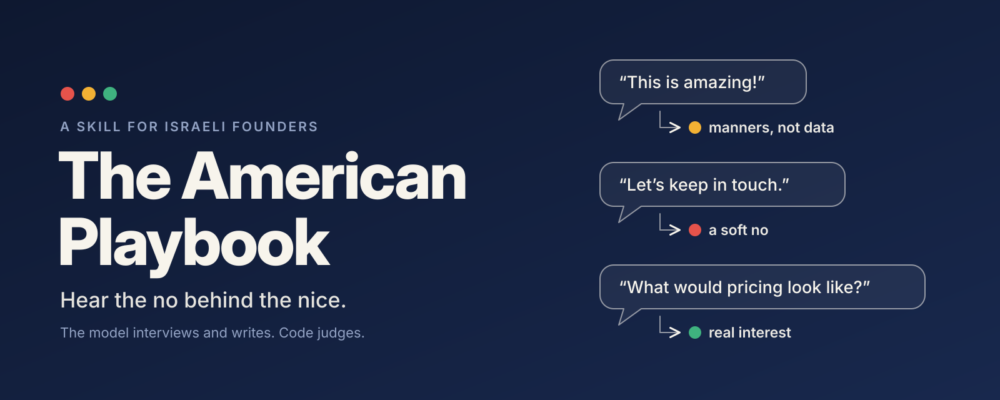
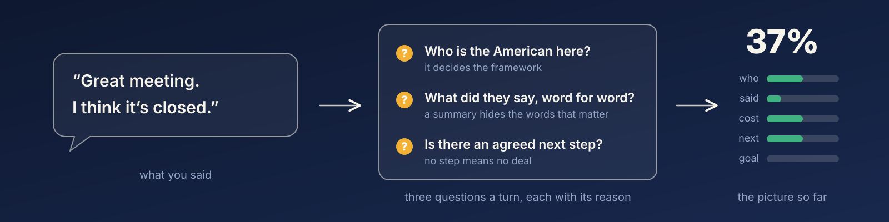
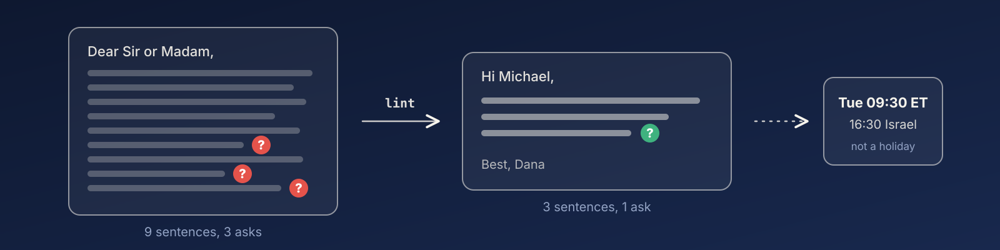
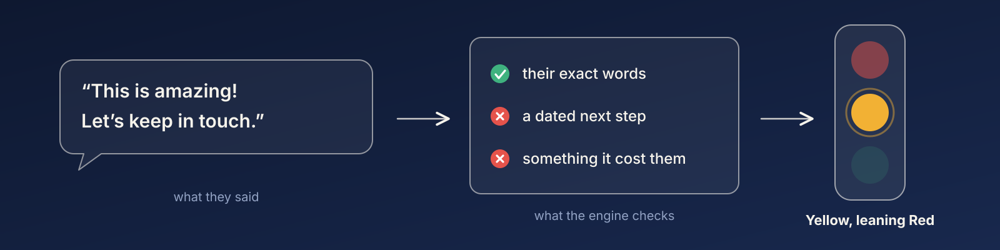
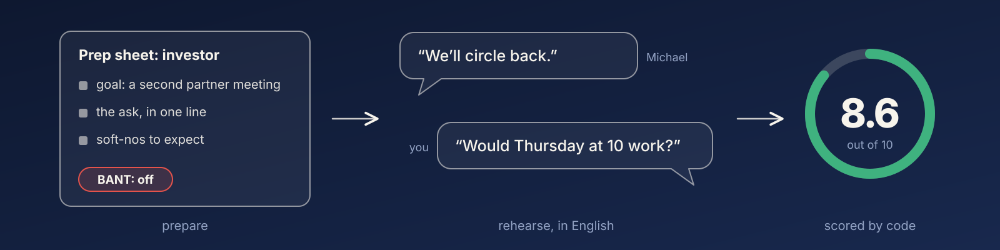

<!-- THIRD-PARTY: founder-skills (page structure, rewritten). See THIRD_PARTY_NOTICES.md. -->
<p align="center">
  
</p>

[](https://github.com/Nimrod-Zemel/american-business-playbook/actions/workflows/ci.yml)
[](LICENSE)
[](https://www.python.org/downloads/)
[](https://agentskills.io)
[](https://code.claude.com/docs/en/plugins)
[](SECURITY.md)
[](SECURITY.md)

**A coaching skill for Israeli founders who sell, fundraise and network in the US.** By [Nimrod Zemel](https://github.com/Nimrod-Zemel), built on [the guide](docs/guide/) he wrote with [Dan Launchpad](https://www.danlaunchpad.co.il/), Tel Aviv University's venture enhancement program.

Israeli founders hear "yes" where a polite American said "no", and sound aggressive where they meant to be efficient. This skill works on that gap in three places: the email you are about to send, the meeting you just had, and the meeting you are about to have. You talk to it in Hebrew or English. What goes out is clean American English.

It is built so that it cannot flatter you. It asks before it answers, from a bank of 117 questions, and it asks for the bad news as hard as for the good. The model asks and writes. A Python engine picks the questions and does the judging, so the same story gets the same questions and the same verdict every time.

[עברית בהמשך הדף](#hebrew)

## Contents

- [What it does](#what-it-does)
  - [The Interview](#the-interview)
  - [Email Doctor](#email-doctor)
  - [Meeting Decoder](#meeting-decoder)
  - [Prep and Simulation](#prep-and-simulation)
  - [Also in the box](#also-in-the-box)
- [Getting started](#getting-started)
  - [Claude: desktop, web and mobile](#claude-desktop-web-and-mobile)
  - [Claude Code](#claude-code)
  - [Other agents](#other-agents)
  - [Without code execution](#without-code-execution)
  - [What to expect on your first run](#what-to-expect-on-your-first-run)
- [How it works](#how-it-works)
- [Privacy and trust](#privacy-and-trust)
- [Honest limits](#honest-limits)
- [Troubleshooting](#troubleshooting)
- [Development](#development)
- [Acknowledgments](#acknowledgments)
- [Contact](#contact)
- [License](#license)
- [עברית](#hebrew)

## What it does

<picture>
  <source media="(prefers-color-scheme: dark)" srcset="assets/the-interview.png">
  <source media="(prefers-color-scheme: light)" srcset="assets/the-interview-light.png">
  
</picture>

### The Interview

It asks before it answers. Every mode starts here.

**What it does:**
- Draws on a bank of 117 questions in 11 areas: who they are, how you got here, what was said, what it cost them, what happens next, what you want, your side, what you can prove, the message itself, what could go wrong, time and place
- Asks at most three a turn, the must-know facts first, and only what your situation calls for. A recap is not asked what a cold email is asked
- Says why it asks. Every question carries its reason
- Asks for the bad news as hard as for the good. The deferral you forgot to mention counts as much as the compliment you remembered
- Answers as soon as the must-know facts are in, then sharpens the answer for as long as you keep answering
- Picks the questions in code, not by the model's mood

**What to provide:** Short answers. A voice note where the story is long. "I don't know" is an answer, and so is "enough".

**What you get back:** The picture so far, area by area, and then a verdict, an email or a prep sheet that names whatever it did not get to ask.

**Example prompts:**
- "Ask me whatever you need before you answer."
- "Just the must-know questions, I'm in a hurry."
- "Enough questions. Work with what you have."

<picture>
  <source media="(prefers-color-scheme: dark)" srcset="assets/email-doctor.png">
  <source media="(prefers-color-scheme: light)" srcset="assets/email-doctor-light.png">
  
</picture>

### Email Doctor

Turns an Israeli email into one an American will answer.

**What it does:**
- Measures your draft before touching it: sentences, asks, softeners, command tone
- Rewrites it in the American register: short, one closed ask, an easy way to say no, a subject line that says something
- Checks every figure against what you actually gave it. A number that came from nowhere stops the email
- Picks the moment to send: Tuesday to Thursday morning in their time zone, shown on your clock too, around US holidays
- Plans the follow-up cadence: five touches over about 90 days, each with its own template

**What to provide:** A draft in any state, or just who you are writing to and what you want from them. Hebrew is fine.

**What you get back:** A send-ready email in English, the time to send it on both clocks, and one line on the habit worth fixing.

**Example prompts:**
- "Americanize this email." (with your draft pasted in)
- "Write a cold email to the VP Claims at an insurer in Boston. We cut claims handling time by 31% for two carriers."
- "I met a customer in Chicago yesterday. When should each follow-up go out?"

<picture>
  <source media="(prefers-color-scheme: dark)" srcset="assets/meeting-decoder.png">
  <source media="(prefers-color-scheme: light)" srcset="assets/meeting-decoder-light.png">
  
</picture>

### Meeting Decoder

Tells you what the meeting was worth, not how it felt.

**What it does:**
- Asks for the three facts that decide it: their exact words, the next step and who proposed it, and what the meeting has cost them so far
- Decodes 18 polite American lines ("Let's keep in touch", "Send me a deck", "It's a bit early for us") into what they usually mean and what to do about it
- Knows the 6 political asides a founder should stay out of, and the line that bridges back to business
- Calibrates compliments: "amazing" is manners, a question about pricing is interest
- Gives a traffic-light verdict, Green, Yellow or Red, from the facts. No facts, no verdict
- Prescribes the next touch, its template and its date

**What to provide:** What they said, as close to word for word as you remember. A voice-note transcript works well.

**What you get back:** A one-line honest verdict, the evidence behind it, the line that was a soft no, and the next move with a date.

**Example prompts:**
- "I had an excellent meeting with their VP. I think it's closed, right?"
- "They said 'keep us posted'. What does that actually mean?"
- "Debrief yesterday's meeting with the investor."

<picture>
  <source media="(prefers-color-scheme: dark)" srcset="assets/prep-and-simulation.png">
  <source media="(prefers-color-scheme: light)" srcset="assets/prep-and-simulation-light.png">
  
</picture>

### Prep and Simulation

Walk into the meeting having already had it.

**What it does:**
- Builds a one-page prep sheet for a customer, an investor or a domain expert, with the opening frame, the hard stop and a small-talk bridge
- Uses BANT in sales meetings and switches it off for investors, where it burns the meeting
- Checks your question list for moves that backfire: BANT aimed at an investor, trashing a competitor, forbidden small talk
- Plays a realistic American who never says no directly, and injects the soft-nos you need to practice catching
- Drops a political aside into the rehearsal when you ask, so you practice staying out of it
- Stops when you say STOP, scores the transcript out of 10, and lists your Israeli-isms next to the American phrasing

**What to provide:** Who you are meeting, when, and the one thing you want to walk out with.

**What you get back:** A prep sheet, a rehearsal in English, and a debrief: the score, which signals you caught and missed, and one drill for next time.

**Example prompts:**
- "I have a first meeting with a partner at a seed fund in New York. Prep me."
- "Start a simulation of a sales call with an American VP Operations."
- "Check these questions before my investor call: ..."

Every prompt works in Hebrew too. There are Hebrew examples in the [Hebrew section](#hebrew).

### Also in the box

- **Intros.** The forwardable blurb that makes an intro easy to give, the reply inside 24 hours, and closing the loop with whoever opened the door.
- **The bench.** When a question needs a person, it points you to the right member of the Dan Launchpad team. Another program can swap the bench for its own or switch it off.
- **15 email templates** from the guide, from the cold email to the graceful breakup. An unfilled slot stays a visible bracket and the email will not pass until you fill it.
- **The guide itself.** The American Playbook, version 2, is in [`docs/guide/`](docs/guide/): the Word file and a reading copy. A check on every build confirms that each English line the guide teaches is in the engine's tables.

> The technical spec the agent reads is [`skills/american-business-playbook/SKILL.md`](skills/american-business-playbook/SKILL.md). It is not required reading.

## Getting started

### Claude: desktop, web and mobile

1. Download **`american-business-playbook.zip`** from the [latest release](https://github.com/Nimrod-Zemel/american-business-playbook/releases/latest). Not the "Source code" files that GitHub adds on its own.
2. In Claude, open **Customize**, then **Skills**.
3. Press **+**, choose **Create skill**, then **Upload a skill**, and pick the zip.
4. Check that code execution is on: **Settings**, then **Capabilities**. The skill's engine needs it.

> If Claude says a skill with this name already exists, remove the old version first. Menus move from time to time, so [Anthropic's guide to skills](https://support.claude.com/en/articles/12512180) is the reference.

### Claude Code

```text
/plugin marketplace add Nimrod-Zemel/american-business-playbook
/plugin install american-business-playbook@venture-engineer
```

Claude Code runs the engine on your machine, so it needs Python 3.9 or newer. Nothing else: there are no packages to install.

### Other agents

The skill follows the open [Agent Skills](https://agentskills.io) format and is one self-contained folder, so an agent that loads skills and can run Python should be able to use it: unzip the release package into that agent's skills folder.

**It is built for Claude and has not been tried in other agents yet, so we make no claim for them.** If you try one, [tell us how it went](https://github.com/Nimrod-Zemel/american-business-playbook/issues).

### Without code execution

For a Gemini Gem or a custom GPT, use **`GEMINI-GEM.md`** from the release: the whole playbook in one file. There is no engine there, so the model reads the tables itself and marks every answer `NOT VERIFIED BY CODE`. You lose the guarantee that the same facts give the same verdict.

### What to expect on your first run

- **Talk to it like a mentor.** Paste the draft, describe the meeting, say who you are about to meet. Hebrew or English.
- **Name it if it stays quiet.** If the agent answers from general knowledge, say "use the american-business-playbook skill".
- **It asks before it judges.** Up to three short questions a turn, each with its reason. Usually the first are: what exactly did they say, is there a next step, and what has it cost them. Once those are in you get an answer, and it keeps sharpening while you keep answering. Say "enough" and it works with what it has.
- **It is fast.** The engine answers in a fraction of a second. There are no long runs.
- **Hebrew for coaching, English for deliverables.** The email, the talk track and the simulation are in English because that is how they will be used.
- **Every answer ends with a stamp**, like `[verified by code: american-business-playbook 2.0.0 | rules ba006f201cf4 | seal ok]`. It names the engine version, the rule tables in use and anything that was not checked. `NOT VERIFIED BY CODE` means the engine did not run and you are reading the model's own judgment.

## How it works

| The model | The engine |
|---|---|
| Asks you the questions, in your language | Picks the questions from the bank and builds the fact sheets from your answers |
| Relays what the engine said | Decides the verdict: Green, Yellow or Red |
| Writes the English | Counts sentences and asks, flags command tone, checks every figure against what you said |
| Plays the American in a simulation | Picks the lines to inject and scores the transcript |
| Tells you when to send | Computes send times on both clocks, around US holidays |

The whole guide lives in `data/*.json` as rule tables: the Sugar-Coated No table, compliment calibration, the signal traffic light, adapted BANT, investor-speak, the cadence, the templates. The question bank sits next to them. The engine runs on those tables and the reference files are generated from them, so the documentation cannot drift from the behavior.

<details>
<summary><b>See what the engine actually prints</b></summary>

A founder reports an excellent meeting. The engine does not rule on a mood. It names the three facts it cannot work without, and why:

<!-- demo:interview-open -->
```console
$ python3 scripts/playbook.py interview --lang en --in - <<'JSON'
{
  "mode": "decode",
  "today": "2026-11-24",
  "answers": {}
}
JSON
Picture so far (a meeting or thread to decode): 0 of 17 facts known, 0%
Depth: standard: the musts, and what sharpens the answer
- Who they are: 0/2 (missing: context)
- How you got here: 0/3
- What was said: 0/5 (missing: quotes)
- What it cost them: 0/1 (missing: cost_to_them)
- What happens next: 0/2 (missing: next_step_exists)
- What you want: 0/2
- Time and place: 0/2
Ask next (at most 3 per turn):
1. [must] Who is the American here: a customer or partner, an investor, or a domain expert?
   why: It decides the framework. BANT runs only in sales, and an investor's "keep us posted" is read differently from a customer's.
   answers.context = one of: sales | investor | kol
2. [must] What did they say, as close to word for word as you remember? Two or three lines are enough. (a voice note is fine)
   why: The engine decodes wording. A summary hides exactly the words that matter.
   answers.quotes = a list of their lines, word for word
3. [must] Is there an agreed next step? Yes or no.
   why: No step means no deal, whatever the mood in the room was.
   answers.next_step_exists = true or false
14 more wait at this depth. If the founder already answered one, record it now and do not ask it: cost_to_them, their_questions, deferral_lines, pushback, meeting_date, touches_sent, touches_done, their_city, decision_needed, meeting_goal_was, your_promises, their_role, how_met, quotes_source
not enough yet for decode: context, quotes, next_step, cost_to_them
[verified by code: american-business-playbook 2.0.0 | rules ba006f201cf4 | seal ok | not checked: decode]
```
<!-- /demo -->

With the answers in, the engine writes the fact sheet itself, and the verdict follows:

<!-- demo:decode-verdict -->
```console
$ python3 scripts/playbook.py decode --lang en --in - <<'JSON'
{
  "context": "sales",
  "today": "2026-11-24",
  "meeting_date": "2026-11-23",
  "tz": "ET",
  "quotes": [
    "This is amazing! Let's keep in touch."
  ],
  "next_step": {
    "exists": false
  },
  "cost_to_them": [],
  "their_questions": 0
}
JSON
Verdict: Yellow, leaning Red: nothing here has cost them anything yet.
Why:
- [yellow] General compliments with no step attached (This is amazing! Let's keep in touch.)
- dated next step: no
- currencies they paid: none
Decoded:
- "This is amazing! Let's keep in touch." -> A soft no. No step means no deal. move: Ask: "What would need to change for this to become relevant?"
Compliment calibration:
- "This is amazing! Let's keep in touch." -> Nice. A social default, not data
Iron rule: Words are free. Commitment is measured only in currencies that cost something: calendar time, data access, an intro, a signature, or money. Everything else is atmosphere.
Next move: Recap (template recap). Next touch in the cadence.
  send: Tue 24 Nov 2026 09:30 ET = 16:30 Israel
  (within 24 hours of the meeting; holiday window, send anyway - recaps do not wait)
  then: Value touch (template value_bump), Mon 30 Nov 2026
Permission-to-say-no line: "Should I close this out on my end, or would it make sense to reconnect in Q2?"
Arm the next interaction with:
- "What's the weakest part of what I just showed you?"
- "If you had to bet on why this fails, what would you bet on?"
- "What would make this a clear no for you?"
One follow-up: What is the smallest step that would cost them something this week?
[verified by code: american-business-playbook 2.0.0 | rules ba006f201cf4 | seal ok]
```
<!-- /demo -->

More, for every command: [docs/EXAMPLES.md](docs/EXAMPLES.md).

</details>

The design, the start-up order and what was deliberately left out: [docs/ARCHITECTURE.md](docs/ARCHITECTURE.md).

## Privacy and trust

Your drafts and meeting notes stay in your agent's session. **The skill sends nothing anywhere and nothing is collected.**

| | |
|---|---|
| Network | None. No networking module is imported |
| Other programs | None. No subprocess, no shell, no `eval` |
| Environment variables, credentials | Never read |
| Hooks, MCP servers, settings | None |
| Files written | One, only when you ask: a calendar file from `cadence --ics` |
| Files read | Its own rule tables, plus the draft or fact sheet you hand it |
| Dependencies | The Python standard library |

These are tested claims. A static audit runs on every build ([docs/AUDIT.md](docs/AUDIT.md)), and the tests plant violations to prove the audit catches them.

Two layers protect the files themselves:

- **A seal.** `seal.json` holds a sha256 of every shipped file. The engine checks it before it loads anything else and refuses to answer if a file changed or a file was planted.
- **Release provenance.** Each release is built by GitHub Actions and carries a signed attestation:

  ```bash
  gh attestation verify american-business-playbook.zip --repo Nimrod-Zemel/american-business-playbook
  ```

The seal detects change. It is not a signature. Details and limits: [SECURITY.md](SECURITY.md).

## Honest limits

- **The engine judges the facts it is given.** If the model fills the fact sheet optimistically, the verdict inherits that. The sheet demands verbatim quotes and evidence for every signal. That narrows the gap. It does not close it.
- **The questions are a bank, not a mind reader.** The engine picks from 117 written questions. A situation the bank does not cover gets no invented question, and an answer is only as true as the founder's memory of the room.
- **Phrase tables match wording, not meaning.** A line the tables do not know is reported as unrecognized. It is never guessed.
- **Some thresholds are engineering choices.** The guide says "reply within hours". Code needs a number. Every such call is tagged in the data and listed in [docs/ASSUMPTIONS.md](docs/ASSUMPTIONS.md).
- **Model-level evals were not run for 2.0.0.** The cases are in [`evals/`](evals). The 1.1.0 benchmark does not carry over to a rebuilt skill.
- **US, B2B.** A coach, not legal, visa or investment-document advice.

## Troubleshooting

**The agent answers without the skill.** Name it: "use the american-business-playbook skill". Check that it is switched on under Customize, then Skills.

**Every answer says `NOT VERIFIED BY CODE`.** The engine is not running. In Claude, switch on code execution under Settings, then Capabilities. In Claude Code, check that `python3 --version` prints 3.9 or newer.

**`SEAL BROKEN`.** A file in the installed skill differs from the release. Reinstall from the release package. Do not pass `--unsealed` to get around it.

**Two versions answer at once.** Remove version 1.1.0, so only one copy is installed.

**The send time is in the wrong zone.** Say where the recipient is: a city or ET, CT, MT, PT.

**Check an install by hand**, from the skill folder:

```bash
python3 scripts/playbook.py doctor
```

## Development

Nothing to install. Python 3.9 or newer is enough.

```bash
git clone https://github.com/Nimrod-Zemel/american-business-playbook.git
cd american-business-playbook
python3 tools/build.py     # references, self-audit, credits, guide, seal, tests
```

Most changes are a change to a rule, and rules are JSON:

1. Edit a table under `skills/american-business-playbook/data/`.
2. Run `python3 tools/build.py`.
3. Commit. CI repeats all of it on Python 3.9 to 3.15.

```text
skills/american-business-playbook/
  SKILL.md, SKILL_HE.md   what the model reads
  data/*.json             the guide as rule tables, and the question bank
  scripts/playbook.py     the engine: 14 commands, standard library only
  references/*.md         generated from the tables
  seal.json               sha256 of every shipped file
tools/                    build, seal, audit, credits check, guide check, package, mutation check
tests/                    unittest suite
evals/                    model-level cases for `claude plugin eval`
docs/                     architecture, assumptions, audit, examples, releasing
docs/guide/               the Word guide the rules come from, and a reading copy
licenses/                 the license text of every source, unmodified
```

More: [CONTRIBUTING.md](CONTRIBUTING.md), [docs/ARCHITECTURE.md](docs/ARCHITECTURE.md), [docs/RELEASING.md](docs/RELEASING.md).

## Acknowledgments

Each credit is for what actually came from where. The full record, with commits and license texts, is in [THIRD_PARTY_NOTICES.md](THIRD_PARTY_NOTICES.md).

- **[Yaniv Golan](https://github.com/yaniv-golan)** of lool ventures, who writes founder-skills. His [proof-engine](https://github.com/yaniv-golan/proof-engine) (MIT) is where the layout of the citation file comes from.
- **[Skills IL](https://github.com/skills-il)** (MIT). The Hebrew companion file, the `metadata.json` layout, and the validator rules that the tests write again in Python.
- **[Garry Tan](https://github.com/garrytan/gstack), gstack** (MIT). The format of the third-party notices, and the rule that rewriting is not an exemption from credit.
- **[Cisco AI Defense](https://github.com/cisco-ai-defense/skill-scanner), skill-scanner** (Apache-2.0). Scanned the skill before release. The result is in [SECURITY.md](SECURITY.md). It is not bundled.
- **[Dan Launchpad](https://www.danlaunchpad.co.il/)**, Tel Aviv University. The program the guide was written with and for, and the team the bench introduces.
- **Further reading the guide points to:** Erin Meyer, [The Culture Map](https://erinmeyer.com/). Rob Fitzpatrick, [The Mom Test](https://www.momtestbook.com/).

## Contact

- **Bugs, and rules that feel wrong:** [GitHub Issues](https://github.com/Nimrod-Zemel/american-business-playbook/issues)
- **Security problems:** [report privately](https://github.com/Nimrod-Zemel/american-business-playbook/security/advisories/new), see [SECURITY.md](SECURITY.md)
- **Dan Launchpad:** [danlaunchpad.co.il](https://www.danlaunchpad.co.il/)

## License

[Apache 2.0](LICENSE) for the software, the rule tables and the documentation. To cite it, see [CITATION.cff](CITATION.cff).

The guide in [`docs/guide/`](docs/guide/) is not under that license. It keeps its own terms, stated in [docs/guide/README.md](docs/guide/README.md).

---

<a id="hebrew"></a>

<div dir="rtl">

## עברית

**סקיל אימון ליזמים ישראלים שמוכרים, מגייסים ובונים קשרים בארה"ב.** מאת נמרוד זמל, על בסיס [המדריך](docs/guide/) שכתב יחד עם Dan Launchpad, תוכנית ה-venture enhancement של אוניברסיטת תל אביב.

יזם ישראלי שומע "כן" במקום שבו אמריקאי מנומס אמר "לא", ונשמע אגרסיבי כשהתכוון להיות יעיל. הסקיל עובד על הפער הזה בשלושה מקומות: המייל שאתה עומד לשלוח, הפגישה שהייתה לך, והפגישה שעוד לפניך. מדברים איתו בעברית או באנגלית. מה שיוצא החוצה הוא אנגלית אמריקאית נקייה.

הוא בנוי כך שהוא לא יכול להחמיא לך. הוא שואל לפני שהוא עונה, מתוך בנק של 117 שאלות, ושואל על החדשות הרעות באותה נחישות כמו על הטובות. המודל שואל וכותב. מנוע Python בוחר את השאלות ושופט, ולכן אותו סיפור מקבל אותן שאלות ואותה פסיקה בכל פעם.

### מה הוא עושה

**הראיון.** הוא שואל לפני שהוא עונה. כל מוד מתחיל כאן.
- בנק של 117 שאלות ב-11 תחומים: מי הם, איך הגעתם לכאן, מה נאמר, מה זה עלה להם, מה קורה עכשיו, מה אתה רוצה, הצד שלך, מה אתה יכול להוכיח, ההודעה עצמה, מה יכול להשתבש, זמן ומקום
- עד שלוש שאלות בסבב, קודם עובדות החובה, ורק מה שהמצב שלך דורש. ריקאפ לא נשאל מה שמייל קר נשאל
- לכל שאלה יש סיבה, והוא אומר אותה
- שואל על הדחייה ששכחת להזכיר באותה רצינות כמו על המחמאה שזכרת
- עונה ברגע שעובדות החובה בפנים, וממשיך לחדד כל עוד אתה עונה. "מספיק" היא תשובה לגיטימית
- את השאלות בוחר הקוד, לא מצב הרוח של המודל

**דוקטור המיילים.** הופך מייל ישראלי למייל שאמריקאי עונה עליו.
- מודד את הטיוטה לפני שהוא נוגע בה: משפטים, בקשות, ריכוכים, טון פקודתי
- כותב מחדש במשלב אמריקאי: קצר, בקשה סגורה אחת, דרך קלה לסרב, שורת נושא שאומרת משהו
- בודק כל מספר מול החומר שנתת לו. מספר שהגיע משום מקום עוצר את המייל
- בוחר מתי לשלוח: שלישי עד חמישי בבוקר לפי השעון של הנמען, גם בשעון ישראל, סביב חגים אמריקאיים
- מתכנן את קיידנס הפולואפ: חמש נגיעות על פני כ-90 יום

**מפענח הפגישות.** אומר מה הפגישה הייתה שווה, לא איך היא הרגישה.
- שואל על שלוש העובדות שמכריעות: המילים המדויקות שלהם, הצעד הבא ומי הציע אותו, ומה הפגישה עלתה להם
- מפענח 18 משפטים אמריקאיים מנומסים למה שהם בדרך כלל אומרים, ומה עושים איתם
- מכיר את 6 האמירות הפוליטיות שיזם צריך להישאר מחוץ להן, ואת המשפט שמגשר בחזרה לביזנס
- נותן פסיקת רמזור, ירוק, צהוב או אדום, מתוך העובדות. בלי עובדות אין פסיקה
- קובע את הנגיעה הבאה, את התבנית ואת התאריך

**הכנה וסימולציה.** להיכנס לפגישה אחרי שכבר עברת אותה.
- בונה דף הכנה לפגישה עם לקוח, משקיע או מומחה, כולל משפט המסגרת, ה-hard stop וגשר לסמול-טוק
- משתמש ב-BANT במכירות ומכבה אותו מול משקיעים, כי שם הוא שורף את הפגישה
- משחק אמריקאי מציאותי שלעולם לא אומר "לא" ישירות, עוצר כשכותבים STOP, ונותן ציון מ-10
- מציג את הישראליזמים שלך לצד הניסוח האמריקאי

**וגם:** כללי אינטרו, 15 תבניות מייל מהמדריך, והספסל, שמפנה לאיש הצוות הנכון ב-Dan Launchpad. תוכנית אחרת יכולה להחליף את הספסל או לכבות אותו. המדריך עצמו, The American Playbook גרסה 2, נמצא ב-[`docs/guide/`](docs/guide/), ובדיקה בכל בנייה מוודאת שכל שורה באנגלית שהוא מלמד קיימת בטבלאות המנוע.

### דוגמאות לבקשות

- "תרגם לי את המייל הזה לאמריקאית" (ומדביקים את הטיוטה)
- "נפגשתי אתמול עם לקוח בשיקגו. מתי לשלוח כל פולואפ?"
- "הייתה לי פגישה מצוינת עם ה-VP. נראה לי שזה סגור, לא?"
- "נתח לי את הפגישה עם המשקיעה מאתמול"
- "יש לי פגישה ראשונה עם שותפה בקרן סיד בניו יורק. תכין אותי."
- "תתחיל סימולציה של שיחת מכירה עם VP Operations אמריקאי"
- "תשאל אותי מה שצריך לפני שאתה עונה"

### איך זה נראה

יזם מדווח על פגישה מצוינת: האמריקאי אמר "This is amazing! Let's keep in touch.", אין צעד הבא, והפגישה לא עלתה לו כלום. זה מה שהמנוע מחזיר, מילה במילה:

<!-- demo:decode-verdict:he:output -->
```text
פסיקה: צהוב נוטה לאדום: שום דבר כאן עוד לא עלה להם משהו.
למה:
- [yellow] מחמאות כלליות בלי צעד מחובר (This is amazing! Let's keep in touch.)
- צעד הבא עם תאריך: לא
- מטבעות ששילמו: אין
פענוח:
- "This is amazing! Let's keep in touch." -> לא רך. בלי צעד אין עסקה. מהלך: לשאול: "What would need to change for this to become relevant?"
כיול מחמאות:
- "This is amazing! Let's keep in touch." -> נחמד. ברירת מחדל חברתית, לא דאטה
כלל הברזל: מילים הן חינם. מחויבות נמדדת רק במטבעות שעולים משהו: זמן ביומן, גישה לדאטה, אינטרו, חתימה או כסף. כל השאר אווירה.
הצעד הבא: ריקאפ (תבנית recap). הנגיעה הבאה בקיידנס.
  שליחה: Tue 24 Nov 2026 09:30 ET = 16:30 ישראל
  (תוך 24 שעות מהפגישה; חלון חג, לשלוח בכל זאת - ריקאפ לא מחכה)
  אחר כך: נגיעת ערך (תבנית value_bump), Mon 30 Nov 2026
שורת רשות להגיד לא: "Should I close this out on my end, or would it make sense to reconnect in Q2?"
לצייד את האינטראקציה הבאה ב:
- "What's the weakest part of what I just showed you?"
- "If you had to bet on why this fails, what would you bet on?"
- "What would make this a clear no for you?"
שאלת המשך אחת: מה הצעד הכי קטן שיעלה להם משהו כבר השבוע?
[נבדק בקוד: american-business-playbook 2.0.0 | rules ba006f201cf4 | seal ok]
```
<!-- /demo -->

### התקנה

**Claude (דסקטופ, אתר, מובייל).**
1. מורידים את `american-business-playbook.zip` מ-[הגרסה האחרונה](https://github.com/Nimrod-Zemel/american-business-playbook/releases/latest). לא את קובצי "Source code" ש-GitHub מוסיף לבד.
2. ב-Claude פותחים **Customize**, ואז **Skills**.
3. לוחצים **+**, בוחרים **Create skill**, ואז **Upload a skill**, ובוחרים את הקובץ.
4. מוודאים שהרצת קוד מופעלת: **Settings**, ואז **Capabilities**.

**Claude Code.**

</div>

```text
/plugin marketplace add Nimrod-Zemel/american-business-playbook
/plugin install american-business-playbook@venture-engineer
```

<div dir="rtl">

**בלי הרצת קוד (Gemini Gem, GPT מותאם).** משתמשים ב-`GEMINI-GEM.md` מהגרסה. אין שם מנוע, ולכן כל תשובה מסומנת `NOT VERIFIED BY CODE`.

### למה לצפות בפעם הראשונה

- **מדברים איתו כמו עם מנטור.** מדביקים טיוטה, מתארים פגישה, אומרים את מי פוגשים.
- **הוא שואל לפני שהוא שופט.** עד שלוש שאלות קצרות בסבב, כל אחת עם הסיבה שלה. אחרי עובדות החובה מקבלים תשובה, והוא ממשיך לחדד כל עוד עונים.
- **הוא מהיר.** המנוע עונה בשבריר שנייה.
- **אימון בעברית, תוצרים באנגלית.**
- **כל תשובה נגמרת בחותמת**, למשל `[נבדק בקוד: american-business-playbook 2.0.0 | rules ba006f201cf4 | seal ok]`. אם כתוב `NOT VERIFIED BY CODE`, המנוע לא רץ ומה שקראת הוא שיקול הדעת של המודל.

### פרטיות ואמון

הטיוטות והסיכומים שלך נשארים בסשן של הסוכן. **הסקיל לא שולח שום דבר לשום מקום ולא אוסף כלום.** אין רשת, אין הרצת תוכנות אחרות, אין קריאת סיסמאות או משתני סביבה, אין תלויות מעבר ל-Python עצמו. קובץ אחד נכתב, ורק לפי בקשה: קובץ יומן מ-`cadence --ics`.

כל קובץ בחבילה חתום ב-sha256 והמנוע מסרב לענות אם קובץ השתנה. כל גרסה נבנית ב-GitHub Actions ונושאת אישור מקור חתום. הפרטים והמגבלות: [SECURITY.md](SECURITY.md).

### מגבלות, ביושר

- **המנוע שופט את העובדות שנותנים לו.** אם המודל ממלא את דף העובדות באופטימיות, הפסיקה יורשת את זה.
- **השאלות הן בנק, לא קריאת מחשבות.** המנוע בוחר מתוך 117 שאלות כתובות. מצב שהבנק לא מכסה לא מקבל שאלה מומצאת, ותשובה נכונה רק כמו הזיכרון של היזם מהחדר.
- **טבלאות הביטויים מזהות ניסוח, לא כוונה.** ניסוח לא מוכר מדווח כלא מזוהה, ולא מנוחש.
- **חלק מהספים הם החלטות הנדסיות.** כולן רשומות ב-[docs/ASSUMPTIONS.md](docs/ASSUMPTIONS.md).
- **בדיקות ברמת המודל לא הורצו לגרסה 2.0.0.**
- **ארה"ב, B2B.** מאמן, לא ייעוץ משפטי, לא ויזות, לא מסמכי השקעה.

### תקלות נפוצות

- **הסוכן עונה בלי הסקיל:** לומר לו במפורש "use the american-business-playbook skill".
- **כל תשובה מסומנת `NOT VERIFIED BY CODE`:** הרצת הקוד כבויה. מפעילים ב-Settings, ואז Capabilities.
- **`SEAL BROKEN`:** קובץ בסקיל המותקן שונה מהגרסה. מתקינים מחדש מחבילת הגרסה.
- **שתי גרסאות עונות יחד:** מסירים את גרסה 1.1.0.

### תודות

כל קרדיט הוא על מה שבאמת הגיע מהמקור. הרשומה המלאה, עם commit וטקסט רישיון לכל מקור, נמצאת ב-[THIRD_PARTY_NOTICES.md](THIRD_PARTY_NOTICES.md).

- **[Yaniv Golan](https://github.com/yaniv-golan)** מ-lool ventures, שכותב את founder-skills. מבנה קובץ הציטוט מגיע מ-[proof-engine](https://github.com/yaniv-golan/proof-engine) שלו.
- **[Skills IL](https://github.com/skills-il)**: קובץ ההוראות בעברית, מבנה `metadata.json`, וכללי הולידציה שהבדיקות כותבות מחדש.
- **[Garry Tan](https://github.com/garrytan/gstack), gstack**: פורמט קובץ הקרדיטים, והכלל ששכתוב אינו פטור מקרדיט.
- **[Cisco AI Defense](https://github.com/cisco-ai-defense/skill-scanner)**: הסורק שבדק את הסקיל לפני הפרסום. התוצאה ב-[SECURITY.md](SECURITY.md).
- **[Dan Launchpad](https://www.danlaunchpad.co.il/)**, אוניברסיטת תל אביב: התוכנית שאיתה ועבורה נכתב המדריך.

### רישיון

[Apache 2.0](LICENSE) לתוכנה, לטבלאות החוקים ולתיעוד. המדריך שב-[`docs/guide/`](docs/guide/) אינו תחת הרישיון הזה: התנאים שלו כתובים ב-[docs/guide/README.md](docs/guide/README.md).

מסמכי הפיתוח (ארכיטקטורה, תרומה, אבטחה) כתובים באנגלית. הוראות הסוכן קיימות גם בעברית: [`SKILL_HE.md`](skills/american-business-playbook/SKILL_HE.md).

</div>
