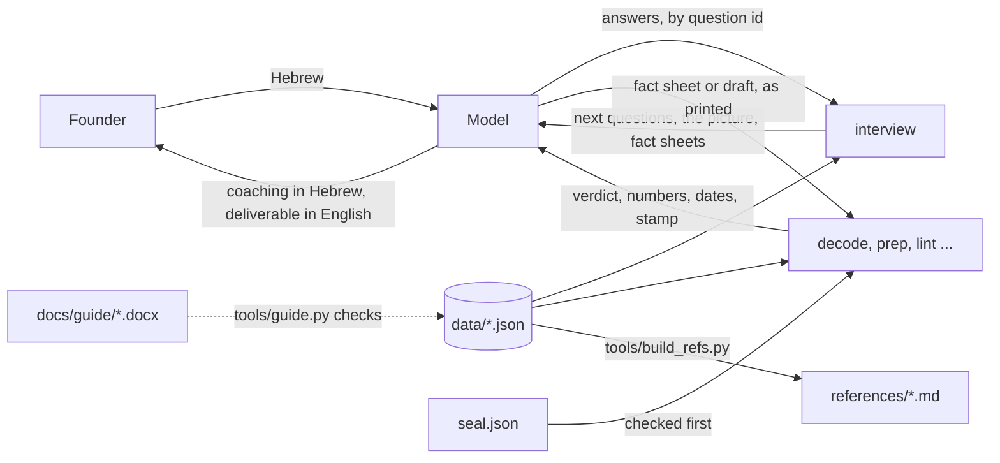

# Architecture

One sentence: **the model interviews and writes, the code judges, and every answer says what the code did not check.** The interview is the model's voice asking the code's questions: what to ask next is decided in code too.

## Why split it this way

A language model is good at two things this skill needs: getting a founder to say what actually happened, and writing warm, short American English. It is unreliable at two others. It does not apply the same table the same way twice: asked for a verdict, it rounds toward the founder's mood. And it does not ask the same questions twice: left to interview on its own, it asks what the story so far suggests, which is how the missing fact stays missing.

Version 1 gave the model the tables as prose and asked it to judge. Version 2 moves every judgment into code, and the choice of questions with it, and leaves the model the two jobs it is good at.

| Job | Who | Why |
|---|---|---|
| Choose what to ask next, and in what order | Code | The same story must get the same questions |
| Ask it, in the founder's language, and record the answer under its id | Model | Conversation |
| Build the fact sheet from the answers | Code | A hand-built sheet is where optimism gets in |
| Decide Green, Yellow or Red | Code | Must be the same every time |
| Count sentences, asks, softeners | Code | Counting |
| Check figures against the founder's material | Code | The model is the one who invents them |
| Compute dates, time zones, holidays | Code | Arithmetic |
| Pick the simulation's injected lines, score the transcript | Code | Whoever plays the scene should not grade it |
| Write the email, play the American | Model | Language |
| Relay the result in Hebrew | Model | Language |

## Flow



1. The model passes `interview` the mode and what the founder has said so far, each answer under the id of its question.
2. The engine validates strictly. An unknown id or field is an error, because a silently dropped fact would silently change a verdict.
3. While a must-know fact is missing, `interview` returns the next questions (three at most, each with its reason) and nothing else may run.
4. Once the musts are in, it also prints the command to run with the fact sheet already built, and goes on asking. The interview and the verdict advance together, round by round.
5. The command applies the rule tables and returns the verdict, the reasons, the next move and its date.
6. The model relays that. If it disagrees, it says so separately and calls it its own reading.

### The question bank

`data/interview.json` holds every question the skill can ask a founder. A question is a row: its id, the area of the picture it fills, how much the answer matters in each mode (1 must, 2 sharpens, 3 depth), when it applies, why it is asked, and what it feeds.

`feeds` is what keeps a broad bank honest. A question either fills a field of a fact sheet, sets an argument of a command, becomes a line of the founder's own material that figures are checked against, or is handed back to the model as context for its writing. The engine's own `check_bank` rejects a question that feeds a field no command has. The tests run it, and so does `doctor` on every install.

Three rules in `interview.py` turn the bank into a conversation:

- **Three a turn, musts first.** Within a level, the questions that move the engine's answer most lead (`lead` in the table).
- **Only what applies.** By mode, by who the American is, and by earlier answers: a recap is asked what was agreed, a cold email is asked why this person and why now.
- **Bad news is asked for by name.** Every Yellow and Red signal of the traffic light is either probed by a question or raised by the decoder from the lines the interview collects. A test holds that line.

The picture it prints (known and missing, area by area, weighted by level) is arithmetic over the same rows. The weights are an engineering choice and are listed in [ASSUMPTIONS.md](ASSUMPTIONS.md).

## The pieces

```text
skills/american-business-playbook/
  SKILL.md, SKILL_HE.md     the protocol: run, ask, relay, stamp
  data/                     10 rule tables, the single source of truth
  scripts/playbook.py       entry point: import hygiene, seal check, dispatch
  scripts/abp/
    core.py                 data loading, errors, the receipt, the stamp
    phrases.py              the phrase-pattern matcher
    schema.py               strict fact-sheet validation
    seal.py                 sha256 manifest, verify only (adapted from founder-skills, see its header)
    clock.py                zones, DST, holidays, send slots, cadence, calendar export
    mail.py                 email parsing, lint, templates
    decode.py               quote matching, the traffic light, the next move
    meeting.py              prep sheets, guards, scenes, debrief scoring
    intro.py                intro protocol, bench routing
    interview.py            the question bank walked: next questions, the picture, the fact sheets
    cli.py                  14 commands, two output formats
  references/               generated from data/
  seal.json                 written by tools/seal.py, never by the engine
  LICENSE.txt, NOTICE.txt   the license and the credits travel inside the package
```

### Rule tables

Everything the guide says is data: phrases, meanings, counter-moves, limits, templates, thresholds, the wording of every message. Each entry carries `origin: playbook` or `origin: extension`.

Four consequences:

- A domain expert changes a rule without reading Python.
- The engine's code is plain ASCII. Every Hebrew word it prints is data, so a look-alike character has nowhere to hide in code.
- The references are rendered from the same tables the engine runs on (`tools/build_refs.py`), so documentation cannot drift from behavior. CI fails when a generated file is stale.
- `docs/EXAMPLES.md` is real engine output for fixed inputs. A rule change shows up there as a diff in the same commit.

### The receipt

Every command builds a receipt: which checks ran, which were skipped and why, what was assumed. The last line of every answer is its one-line form:

```text
[verified by code: american-business-playbook 2.0.0 | rules ba006f201cf4 | seal ok | not checked: numbers_vs_source]
```

`rules` is a fingerprint of the rule tables in use. `not checked` names what did not run: no source file was given, so figures were not verified. The model is told to end its message with this line, and to write `NOT VERIFIED BY CODE` when it could not run the engine at all. A skill that skips a check and still hands out a score is the failure this prevents.

### Determinism

No randomness and no clock unless asked. A simulation scene is chosen by a sha256 of its seed, so the same seed gives the same scene and a debrief can recompute what was injected. Dates come from `--now`, `--today` or the fact sheet. When the system clock is used, the output says so under "Assumptions".

Time zones are computed, not looked up: US and Israeli daylight-saving rules are implemented directly and tested against the IANA database for every day from 2016 to 2040 in seven zones. That removes the dependency on `zoneinfo` data, which is missing on some hosts. Dates outside 2016 to 2099 are refused with a clear error.

### Exit codes

| Code | Meaning |
|---|---|
| 0 | Answered. Includes "more facts needed". |
| 1 | The draft or talk track needs work. |
| 2 | Bad input. The message says what to fix. |
| 3 | The integrity seal is broken. No answer. |

`--format json` gives the same content as a machine-readable object, errors included.

## Start-up order

`scripts/playbook.py` does five things before any rule runs, in this order:

1. Removes its own folder and the working directory from the import path.
2. Loads the standard-library modules the engine needs, from the standard library.
3. Switches cached bytecode off for the engine's modules.
4. Loads only the seal checker and verifies the tree.
5. Loads the rest of the engine, then removes its folder from the import path again.

Steps 1 to 3 exist because the seal covers source files. Without them, a planted `scripts/json.py` or a planted `.pyc` would run under a seal that still says ok. The reasoning and the limits are in [SECURITY.md](../SECURITY.md).

## What is tested, and how

| Layer | What it proves | Where |
|---|---|---|
| Unit tests | Each rule fires on its example and stays quiet on its non-examples | `tests/test_*.py` |
| Table self-tests | Every pattern in every table compiles and matches its own example | `tests/test_tables.py`, `doctor` |
| Parity | The cadence equals the v1 scheduler on 1,096 meeting dates | `tests/test_clock.py` |
| Cross-check | DST math equals the IANA database, 2016 to 2040 | `tests/test_clock.py` |
| Security | The audit finds planted violations. Planted modules and bytecode do not run | `tests/test_security.py` |
| Seal | Every kind of tampering is caught. What installers do is tolerated | `tests/test_seal.py` |
| Interview | The bank has no question for nothing, asks three a turn with musts first, and hands every command a sheet it accepts | `tests/test_interview.py` |
| Guide | Every English line the guide teaches is in a rule table, and the reading copy matches the Word file | `tools/guide.py`, `tests/test_guide.py` |
| Docs | Instructions, commands, versions and generated files agree | `tests/test_docs.py` |
| Credits | Every borrowed file is listed with its source, license and commit | `tools/notices.py`, `tests/test_notices.py` |
| Package | The release file is reproducible and works from a clean extraction | `tests/test_package.py` |
| Mutation check | The tests fail when a rule is broken on purpose | `tools/mutation_check.py` (by hand) |
| Model behavior | The model runs the interview, asks what it returns, relays honestly | `evals/` (not run in CI) |

Everything but the last row is deterministic and free. The last row calls a model, costs money and is run by hand before a release that changes the instructions.

## Deliberately left out

- **No hooks, no MCP server, no background process.** A skill that installs machinery is harder to trust than one that is only files.
- **No orchestration or sub-agents.** One model, one script. A command answers in a fraction of a second.
- **No stored state.** The engine remembers nothing between runs. The model carries the conversation.
- **No dependencies.** Nothing to install, nothing to keep patched.
- **No self-update and no reseal command in the shipped skill.** Writing the seal lives in `tools/`, outside the package.
